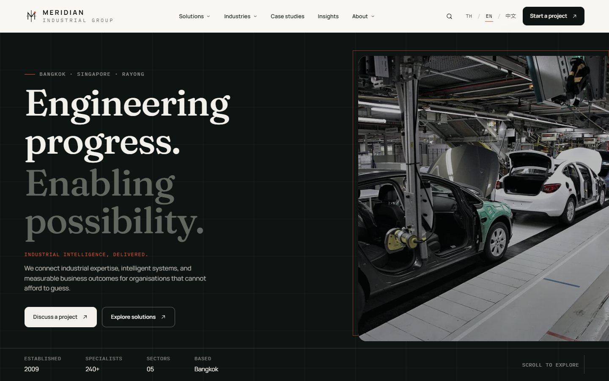
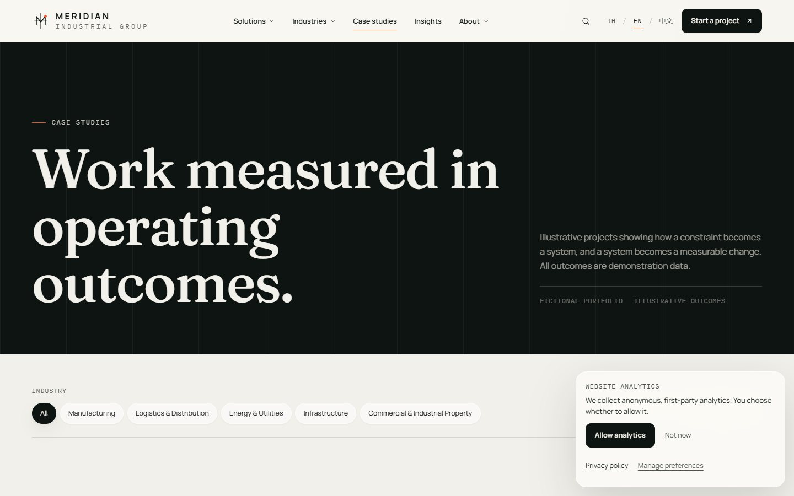
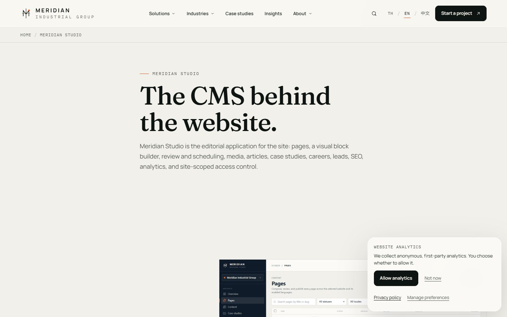
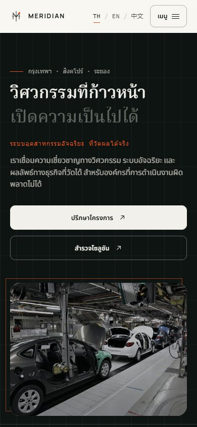

# Meridian Industrial Group

A company website demo for a fictional industrial engineering group, built as a
full stack rather than a mockup: a multilingual public site, a content management
application, and a Laravel API behind them.

[**Live demo**](https://meridian-industrial.netlify.app) ·
[CI](https://github.com/Mindenry/meridian-platform/actions/workflows/ci.yml) ·
[Docs](#documentation)

[](https://github.com/Mindenry/meridian-platform/actions/workflows/ci.yml)



> Meridian is a fictional brand created for portfolio demonstration. The company,
> projects, people, figures, and outcomes are illustrative. See
> [Credits](docs/CREDITS.md) and [Notes](#notes) below.

## What this is

A demonstration of the site a mid-sized engineering company would run: services,
industries, case studies, technical articles, careers, investor relations, and a
contact flow in Thai, English, and Simplified Chinese.

The public site is rendered from a CMS, not from hard-coded templates. Every page
is composed from typed blocks that editors manage in Meridian Studio, and the same
content model serves three locales and two sites. The repository includes the
editorial workflow, a visual page builder, media handling, search, forms, and the
tests that keep it honest.

## What you can review

- **Public site.** Three locales with localised routes, metadata, hreflang,
  sitemaps, RSS, and navigation. Thai and Chinese use their own type scales and
  line-breaking rules. Pages are assembled from blocks: heroes, capability
  indexes, solution grids, project grids, statistics, insights, forms, and more.
- **Content operations.** Draft, review, approve, publish, or schedule, with
  revision snapshots and an idempotent scheduler. The rules live in
  `apps/api/app/Cms`; the screens are in `apps/studio/src/views`.
- **Meridian Studio.** A Vue application for the editorial team: page list,
  block builder with undo/redo and autosave, media library, articles, case
  studies, careers, leads, SEO health, analytics, and site-scoped permissions.
- **Multi-site isolation.** Content, navigation, media, and search are scoped to a
  site, and access is checked against the user's site assignment. The seed data
  includes a second site with its own pages and search documents.
- **Accessibility.** Automated axe checks run against twelve templates, the
  mobile menu, and search, alongside keyboard tests. The public site states its
  conformance target at `/:locale/accessibility`.
- **Operations.** Health checks, backup and restore scripts, and a runbook with a
  restore drill. See [Runbook](docs/RUNBOOK.md).

## Stack

| Part | Technology | Local URL |
| --- | --- | --- |
| API | Laravel 13, Sanctum, Pest | http://localhost:8000 |
| Website | Nuxt 4, Vue 3, TypeScript, Tailwind 4, GSAP | http://localhost:3002 |
| Studio | Vue 3, Vite, TypeScript, Tailwind 4, Tiptap | http://localhost:3003 |
| Data | PostgreSQL 17, Redis 7, Meilisearch, MinIO | internal |
| Runtime | Docker Compose, PHP-FPM, nginx | — |
| Delivery | Netlify (static demo), GitHub Actions | — |

## Live demo

The demo at **https://meridian-industrial.netlify.app** is a static snapshot of
the Laravel API. Netlify builds the Nuxt site with committed fixtures, so no PHP,
database, or object storage is required.

**Works:** every page in Thai, English, and Chinese; navigation and language
switching; search across the snapshot; RSS and sitemaps; the Studio tour at
`/:locale/studio`; accessibility and performance checks.

**Simulated:** form submissions return a demo confirmation and send nothing.
Studio login, editing, media uploads, and CMS previews need the full stack.



The Studio tour at `/:locale/studio` walks through the real CMS screens:



<p align="center">
  
</p>

## Architecture

```
Browser
  │
  ├── website (Nuxt 4, SSR) ──┐
  │                           ├── /api/v1/public/*   Laravel API
  └── Studio (Vue 3 SPA) ─────┘        │
                                       ├── PostgreSQL (content, workflow, leads)
                                       ├── Redis (cache, sessions, queues)
                                       ├── Meilisearch (search; database fallback)
                                       └── S3 / MinIO (media; local disk fallback)
```

The API is the source of truth for content, workflow, permissions, search, and
forms. The public site consumes only `/api/v1/public/*`; Studio uses Sanctum
cookie authentication and `/api/v1/admin/*`. Media is served through the API or a
CDN, and search falls back to the database when Meilisearch is unavailable.

## Run it locally

### Docker, full stack

```bash
cp infrastructure/.env.example infrastructure/.env
docker compose -f infrastructure/compose.yaml up --build
```

The first boot migrates and seeds the demonstration database, creates the media
bucket, and builds the search index. Then open:

- Website: http://localhost:3002
- Studio: http://localhost:3003
- API health: http://localhost:8000/api/v1/health
- MinIO console: http://localhost:9001

### Without Docker

Requirements: PHP 8.3 or newer with `pdo_sqlite`, `gd`, `zip`, and `mbstring`;
Composer 2; Node 22 or newer; pnpm 10.

```bash
cd apps/api
composer install
cp .env.example .env
php artisan key:generate
touch database/database.sqlite
php artisan migrate:fresh --seed
php artisan storage:link

cd ../..
pnpm install
pnpm dev
```

`pnpm dev` starts the API, website, and Studio together. Stop the Docker stack
first if it is running, because both bind ports 8000, 3002, and 3003.

### Demo accounts

Password for every account: `Meridian!2026`.

| Email | Role |
| --- | --- |
| `admin@meridian.example` | Super administrator, both sites |
| `editor@meridian.example` | Content editor, cannot publish |
| `reviewer@meridian.example` | Reviewer, can approve |
| `admin@meridian-energy.example` | Administrator, second site only |

Rotate `APP_KEY`, database, MinIO, Meilisearch, and session values before running
this anywhere shared. See [Deployment](docs/DEPLOYMENT.md).

## Tests

```bash
cd apps/api
php artisan test --compact
vendor/bin/pint --test

cd ../..
pnpm lint
pnpm build

cd apps/e2e
npx playwright test
```

Current state: 30 backend tests with 126 assertions, and 41 Playwright tests. The
browser suite covers publishing, localised metadata, sitemaps and robots, search,
public form submissions, scheduled publishing, cross-site denial, language
switching, accessibility scans, consent, RSS, performance budgets, and the second
site.

To run the browser suite against the Docker stack:

```bash
cd apps/e2e
E2E_DOCKER=1 npx playwright test
```

The static demo build is checked without the API:

```bash
cd apps/website
NUXT_PUBLIC_DEMO_STATIC=true pnpm generate
```

CI runs the backend tests and Pint, Composer audit, website and Studio typechecks
and builds, the static demo build with output checks, a production Compose
validation, and the Playwright suite.

## Deployment

### Static demo on Netlify

The repository root `netlify.toml` builds the static snapshot with
`pnpm --filter @meridian/website generate` and publishes
`apps/website/.output/public`. Leave the Netlify base directory empty; the
configuration installs the workspace from the root. See
[Deployment](docs/DEPLOYMENT.md) for the full guide and environment variables.

### Full stack

The Laravel API cannot run on Netlify. It needs a container host with PostgreSQL,
Redis, object storage, and Meilisearch. The deployment guide covers the API host,
CORS, cookies, DNS, TLS, backups, scaling, and the go-live checklist. A production
Compose override is included at `infrastructure/compose.prod.yaml`.

## Repository layout

```
apps/
  api/         Laravel API, CMS domain logic, migrations, seeders, Pest tests
  website/     Nuxt SSR site, block components, SEO, motion, static demo fixtures
  studio/      Vue CMS, visual builder, editors, lead inbox
  e2e/         Playwright suite and screenshots
infrastructure/
  compose.yaml
  compose.prod.yaml
  docker/      API, nginx, website, and Studio images
  backup.sh    PostgreSQL and media backup
  restore.sh   Restore and reindex
docs/          Architecture, API, database, SEO, security, testing, runbook
```

## Documentation

- [Architecture](docs/ARCHITECTURE.md)
- [Database](docs/DATABASE.md)
- [API](docs/API.md) and [OpenAPI contract](docs/openapi.yaml)
- [SEO](docs/SEO.md)
- [Security](docs/SECURITY.md)
- [Deployment](docs/DEPLOYMENT.md)
- [Operations runbook](docs/RUNBOOK.md)
- [Testing](docs/TESTING.md)
- [Content model](docs/CONTENT_MODEL.md)
- [Page builder](docs/PAGE_BUILDER.md)
- [Decisions](docs/DECISIONS.md)
- [Implementation and verification log](docs/IMPLEMENTATION_PLAN.md)

## Notes

- The brand, clients, projects, and figures are fictional. Nothing here is an
  audited statement or evidence of real work.
- The static demo is a snapshot. Content changes require a new snapshot commit;
  the generation script is `apps/website/scripts/snapshot-demo.mjs`.
- Demo forms do not persist data.
- Automated accessibility checks and keyboard tests are not a substitute for an
  external WCAG audit.
- Error tracking is not wired to an external service. Logs stay in the stack.
- Backups are local by default. There is no WAL archiving, off-site copy, or
  automated retention.
- Search and object storage fall back to the database and local disk when
  Meilisearch or MinIO is unavailable.
- Google Search Console, GA4, and GTM stay disconnected until credentials are
  supplied. The CMS reports that state rather than showing placeholder metrics.

## Credits

Photography is from Wikimedia Commons under the licences listed on the website's
credits page. Display type is Fraunces and Noto Serif Thai; body type is Manrope,
Noto Sans Thai, and IBM Plex Mono, all served through Fontsource. Full attribution
is in [docs/CREDITS.md](docs/CREDITS.md).

The code is published for portfolio review. The Meridian brand, copy, and
demonstration data are fictional; photography retains its original licence.
