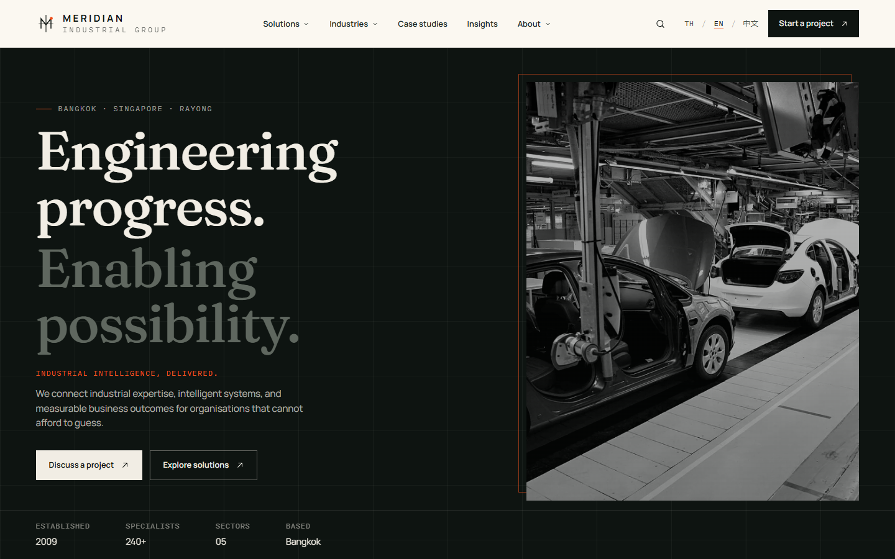
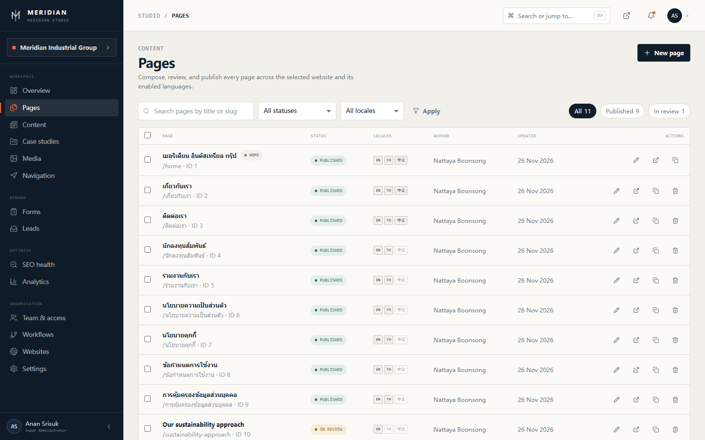

# Meridian

Meridian is a fictional industrial engineering group. This repository is the
website and content platform built around it: a Laravel API, a Nuxt public site
in Thai, English and Simplified Chinese, and a Vue CMS called Meridian Studio.

It is a demonstration project. Every company detail, project, figure and outcome
is illustrative. See [docs/CREDITS.md](docs/CREDITS.md) for image and font
licences.



## Stack

| Part | Technology | Local URL |
| --- | --- | --- |
| API | Laravel 13, Sanctum, Pest | http://localhost:8000 |
| Website | Nuxt 4, Vue 3, TypeScript, Tailwind 4, GSAP | http://localhost:3002 |
| Studio | Vue 3, Vite, TypeScript, Tailwind 4, Tiptap | http://localhost:3003 |
| Data | PostgreSQL 17, Redis 7, Meilisearch, MinIO | internal |
| Runtime | Docker Compose, PHP-FPM, nginx | — |

The website serves `/th` (default), `/en`, and `/zh-cn`. Thai and Chinese use
script-specific typography rather than the Latin type scale.



## Run with Docker

```bash
cp infrastructure/.env.example infrastructure/.env
docker compose -f infrastructure/compose.yaml up --build
```

The first boot migrates and seeds the demonstration database, creates the media
bucket, and builds the search index. Then open:

- Website: http://localhost:3002
- Studio: http://localhost:3003
- API health: http://localhost:8000/api/v1/health
- MinIO console: http://localhost:9001

Demo accounts use the password `Meridian!2026`:

| Email | Role |
| --- | --- |
| `admin@meridian.example` | Super administrator, both sites |
| `editor@meridian.example` | Content editor, cannot publish |
| `reviewer@meridian.example` | Reviewer, can approve |
| `admin@meridian-energy.example` | Administrator, second site only |

Rotate `APP_KEY`, database, MinIO, Meilisearch and session values before running
this anywhere shared. See [docs/DEPLOYMENT.md](docs/DEPLOYMENT.md).

## Run locally

Requirements: PHP 8.3 or newer with `pdo_sqlite`, `gd`, `zip` and `mbstring`;
Composer 2; Node 22 or newer; pnpm 10.

```bash
cd apps/api
composer install
cp .env.example .env
php artisan key:generate
touch database/database.sqlite
php artisan migrate:fresh --seed
php artisan storage:link

cd ../..
pnpm install
pnpm dev
```

`pnpm dev` starts the API, website and Studio together. With PHP already on
`PATH` this is the only command you need after setup. Stop the Docker stack
first if it is running, because both bind ports 8000, 3002 and 3003.

## What to review

- **Publishing workflow.** Draft, review, approve, publish or schedule, with
  revision snapshots and an idempotent scheduler. The rules live in
  `apps/api/app/Cms`; the Studio screens are in `apps/studio/src/views`.
- **Localisation.** Localised routes, metadata, hreflang, sitemaps, RSS and
  navigation. Thai typography and line breaking are handled separately from
  Latin. See [docs/SEO.md](docs/SEO.md) and
  `apps/website/app/assets/css/main.css`.
- **Multi-site isolation.** Content, navigation, media and search are scoped by
  site, and access is checked against the user's site assignment. The seeded
  second site has its own pages and search documents.
- **Accessibility.** Axe checks run against twelve templates, the mobile menu
  and search, alongside keyboard tests. The public site states its conformance
  target at `/:locale/accessibility`.
- **Studio tour.** `/:locale/studio` shows the CMS screens and explains how the
  editorial workflow, block builder and lead inbox fit together.
- **Operations.** Health checks, backup and restore scripts, and a runbook with
  a restore drill. See [docs/RUNBOOK.md](docs/RUNBOOK.md).

## Deploy

### Portfolio demo, no backend

The public site builds as a static snapshot. Netlify runs `pnpm generate` from
`apps/website`; the build reads committed fixtures in `public/demo`, copies the
seed media, and prerenders every route. Search, language switching, RSS and
sitemaps work without the API, and form submissions show a demo confirmation
instead of sending data.

The Studio tour lives at `/:locale/studio` and uses screenshots of the real CMS.
Run it locally with:

```bash
cd apps/website
NUXT_PUBLIC_DEMO_STATIC=true pnpm generate
python -m http.server 4000 --directory .output/public
```

### Full stack

The CMS, live forms, search indexing and multi-site editing need the Laravel API
plus PostgreSQL, Redis, object storage and Meilisearch. Netlify cannot run those
services. `apps/website/netlify.toml` and `apps/studio/netlify.toml` hold the
front-end build settings; [docs/DEPLOYMENT.md](docs/DEPLOYMENT.md) covers the
API host, CORS, cookies, DNS and the go-live checklist.

## Tests

```bash
cd apps/api
php artisan test --compact
vendor/bin/pint --test

cd ../..
pnpm lint
pnpm build

cd apps/e2e
npx playwright test
```

Current state: 30 backend tests with 126 assertions, and 41 Playwright tests.
The browser suite covers publishing, localised metadata, sitemaps and robots,
search, public form submissions, scheduled publishing, cross-site denial,
language switching, accessibility scans, consent, RSS, performance budgets and
the second site.

To run the browser suite against the Docker stack:

```bash
cd apps/e2e
E2E_DOCKER=1 npx playwright test
```

## Layout

```
apps/
  api/         Laravel API, CMS domain logic, migrations, seeders, Pest tests
  website/     Nuxt SSR site, block components, SEO, motion
  studio/      Vue CMS, visual builder, editors, lead inbox
  e2e/         Playwright suite and screenshots
infrastructure/
  compose.yaml
  docker/      API, nginx, website and Studio images
  backup.sh    PostgreSQL and media backup
  restore.sh   Restore and reindex
docs/          Architecture, API, database, SEO, security, testing, runbook
```

## Documentation

- [Architecture](docs/ARCHITECTURE.md)
- [Database](docs/DATABASE.md)
- [API](docs/API.md) and [OpenAPI contract](docs/openapi.yaml)
- [SEO](docs/SEO.md)
- [Security](docs/SECURITY.md)
- [Deployment](docs/DEPLOYMENT.md)
- [Operations runbook](docs/RUNBOOK.md)
- [Testing](docs/TESTING.md)
- [Content model](docs/CONTENT_MODEL.md)
- [Page builder](docs/PAGE_BUILDER.md)
- [Decisions](docs/DECISIONS.md)
- [Implementation and verification log](docs/IMPLEMENTATION_PLAN.md)

## Known constraints

- The brand, clients, projects and figures are fictional. Nothing here is an
  audited statement or evidence of real work.
- Automated accessibility checks and keyboard tests are not a substitute for an
  external WCAG audit.
- Error tracking is not wired to an external service. Logs stay in the stack.
- Backups are local by default. There is no WAL archiving, off-site copy or
  automated retention.
- Search and object storage fall back to the database and local disk when
  Meilisearch or MinIO is unavailable.
- Google Search Console, GA4 and GTM stay disconnected until credentials are
  supplied. The CMS reports that state rather than showing placeholder metrics.

## Credits

Photography is from Wikimedia Commons under the licences listed on the website's
credits page. Display type is Fraunces and Noto Serif Thai; body type is Manrope,
Noto Sans Thai and IBM Plex Mono, all served through Fontsource. Full attribution
is in [docs/CREDITS.md](docs/CREDITS.md).
